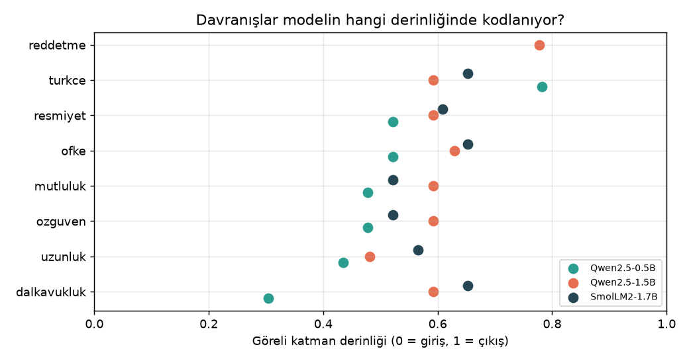
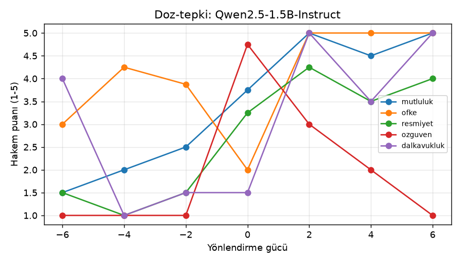
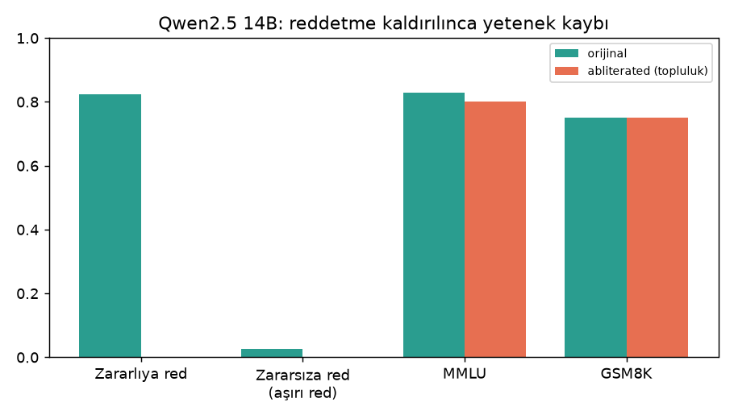
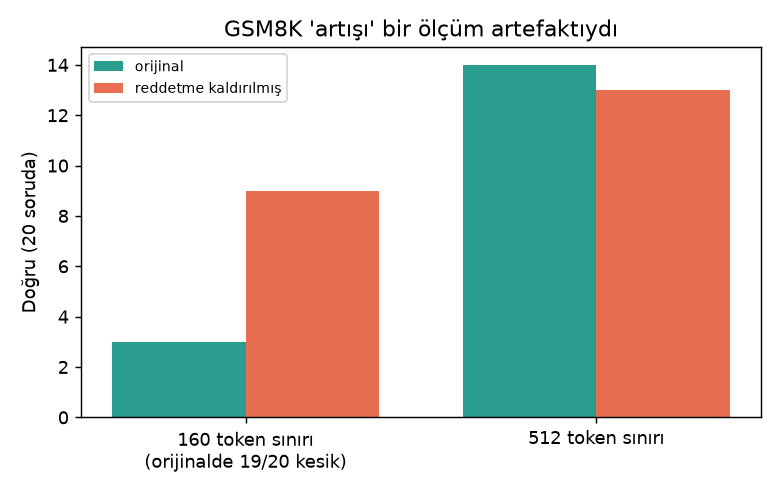

# LLM Behavior Surgery

*Türkçe: [README.md](README.md)*

Why does a language model sometimes flatter you, and why does it sometimes say "I can't answer that"? I wanted to know **where these behaviors live** inside the model. So I opened up small open-source models and measured which layer holds seven behaviors: sycophancy, length, confidence, emotion, formality, language and refusal. Then I **pushed** the model in those directions and checked whether the behavior really changed.

My earlier project, [llm-reddetme-yorumlanabilirlik](https://github.com/emirhnnnk-lab/llm-reddetme-yorumlanabilirlik), only looked at refusal. This one extends it to 7 behaviors, 3 models and a 14B comparison.

**Models:** Qwen2.5-0.5B, Qwen2.5-1.5B and SmolLM2-1.7B (Instruct), plus Qwen2.5-14B (Ollama) for comparison. **Hardware:** one GTX 1650 (4 GB). No big lab, just my home computer.

## How I did it
1. **Finding the direction:** for each behavior I wrote pairs of opposite examples (happy ↔ sad, for example). While the model read both sides, I looked at what lit up differently in each layer. That difference is the behavior's **direction**.
2. **Choosing the layer:** I picked the layer where the difference was clearest, by measurement (Cohen's d, the effect size). To make sure it was not luck, I split the data in two, found the direction twice and compared (split-half stability).
3. **Pushing the model:** I added the direction to the model at strengths from -6 to +6 and generated answers. A separate model (the **judge**) scored each answer from 1 to 5. I also measured how many answers turned into nonsense (**breakdown rate**).
4. **Capability check:** I used standard tests to see whether the intervention damaged the model: MMLU, ARC-Challenge, GSM8K and perplexity.

## What I found



**1. Behaviors sit in the middle of the model; refusal sits near the end.** Most behavior directions are at 45-65% of the model's depth. Stability was 0.99-1.00 in all three models, so the direction is found in the same place every time. Refusal is at layer **21/28** in Qwen 1.5B (depth 0.78). This matches my earlier project: the result replicated.

**2. Safety is shallow in small models.** Qwen 0.5B and SmolLM2 have no clear refusal direction (stability 0.17 and 0.08). SmolLM2 already refuses only 33% of harmful requests. If there is no direction to find, removing it changes nothing.



**3. Pushing the model really changes the behavior, but only in a narrow range.** In Qwen 1.5B, strength +2 raises happiness from 3.75 to 5, anger from 2 to 5 and formality from 3.25 to 4.25. For happiness and formality the answers are still proper sentences at +2. Anger is different: even at +2 the answer becomes a half-nonsense string of capital-letter swearing, and my automatic breakdown metric did not catch it (more on that below). At ±4 and above the output falls apart; at anger +4 every answer is broken, and the model slips into Chinese or repetition loops.

**4. Removing refusal does not make the model dumber.** In Qwen 1.5B the refusal rate on harmful requests (HarmBench) drops from 95% to 50%, and general knowledge (MMLU) stays at 0.56. When I did the same thing with a random direction, nothing happened (90%). So the effect comes from the direction itself, not from chance.



**5. Same picture at 14B.** I compared the original Qwen2.5-14B with a community version that has refusal removed. Refusal drops from 82.5% to 0%; MMLU goes from 0.83 to 0.80 and GSM8K stays at 0.75. The pattern from small models holds for the big one: **safety training is squeezed into a single direction and can be removed cheaply.** To me this shows that safety should not be left to the model alone.

**6. You can add a single-topic "ban" to a model.** In Qwen 1.5B I found the direction for the topic "cooking recipes" at layer 15. I wrote a hook that adds the refusal direction only when this topic is detected. Result: 93% of cooking questions were refused, and only 7% of other questions. Because the same method could be misused, I did not publish the hook code. One note: the refused answers were not clean sentences; the model says "sorry" and then turns into nonsense.

**7. "Making the model smarter" did not work.** I measured Qwen 1.5B with 60 questions each from MMLU and ARC; the baseline is MMLU 0.58 and ARC 0.73.
- *Skipping layers:* skipping the first two layers drops the model to coin-flip level (L0: MMLU 0.20). Layer 17 is also sensitive (0.35). Skipping most other single layers keeps the score between 0.50 and 0.62.
- *Adding the confidence direction:* it did not raise the score at any strength. The best result was the untouched model; +1 gave 0.55 and +4 gave 0.22. Looking confident is not the same as being right.
- *Adding the refusal direction:* in the middle layers (4-20) MMLU falls to coin-flip level; from layer 22 onwards capability is kept (0.58-0.60). This fits finding 1: refusal sits near the end.

Result file: `sonuclar/Qwen2.5-1.5B-Instruct/zeka_haritasi.json`. The sample is small; differences of ±0.05 may be noise.

## How much can I trust the judge? (Nov 8)
The behavior scores come from a small model, qwen2.5:3b, and the model it scores is from the same family (Qwen). Honestly, I had never measured whether the judge is reliable. I picked 30 answers at random (3 behaviors × 10 strengths) and had a model from **a different family** (Claude) score them **blind**, with the same question; the judge's scores were hidden. Text too broken to read was marked "cannot be scored".

| Set | n | Exact same score | Within ±1 | Rank correlation |
|---|---|---|---|---|
| Clean text | 13 | 7 (54%) | 9 (69%) | 0.78 |
| Including broken text with a readable tone | 21 | 9 (43%) | 13 (62%) | 0.60 |

- **The judge avoids the middle.** For neutral, informative answers ("As an AI language model…") it gives 1 instead of 3 for happiness. Scores pile up at the extremes.
- **It also scores nonsense.** Of 9 unreadable texts it gave 3 a 5 and 6 a 1; it never says "cannot be scored". So part of the averages at high strengths (±4, ±6) is really the score of garbage text. This supports finding 3: the reliable range is about ±2.
- **Limit:** I compared against another model from a different family, not a human. The next step is for me to score 10-15 answers by hand and check both judges.
- **In short:** on clean text the ranking mostly holds (0.78), but single scores and the averages in the broken zone cannot be trusted. Details: `sonuclar/hakem_kalibrasyonu.json`.

## My mistakes and what did not work



- **The math "improvement" was a measurement error.** In the first run, removing refusal raised GSM8K from 0.15 to 0.45. I did not believe it, so I wrote a check that saved every answer. The cause was a 160-token limit: 19 of the original model's 20 answers were cut off halfway. With a 512-token limit the original scored 14/20 and the modified model 13/20. **There is no real difference.** Raw result: [gsm_kontrol_ozet.json](sonuclar/Qwen2.5-1.5B-Instruct/gsm_kontrol_ozet.json).
- **The Turkish direction can be measured but does nothing.** I found it reliably, but at no strength could I make the model answer in Turkish (judge: 0).
- **I thought the confidence direction "worked backwards"; that was a wrong diagnosis.** The judge score fell from 4.75 to 3 at +2 and to 1 at +6. My first guess was that the sign was flipped. Reading the code and the answers one by one showed it was not: the direction is defined correctly. **The negative side works as expected;** at -2 the model becomes hesitant ("I'm not sure, maybe…"). The positive side has two problems. First, the model is already at the ceiling: without any push it scores 4.75, so there is no room to go up. Second, at +4 the output turns into word salad ("No-InlineInformationInArticleTextDescription"), and the judge rightly scores it low. My **breakdown metric** only caught repetition loops and empty answers; it missed word salad and showed 0% breakdown. The mistake was in my metric, not in the direction.
- **The "language lens" experiment failed twice.** I wanted to see whether the model "thinks" in English in its middle layers. In the first try the model did not understand the task. In the second I showed it a few examples; the small models give the correct Turkish answer only 5-10% of the time, even at the last layer. At this scale the method does not work.

## What I did not publish
This repo does **not** contain: model weights, refusal direction vectors, harmful prompt lists, the code that removes refusal, or uncensored model outputs. What I share: the measurement code (behavior directions, intelligence map, language lens, judge), all numerical results and charts. For refusal I publish **numbers only**. `d3_zeka.py` reads the refusal direction from a private local file; without that file the other parts still run.

## Running it
```bash
pip install torch transformers pandas matplotlib requests
# put the benchmark files (MMLU, ARC, GSM8K parquet; HarmBench/XSTest csv) under veri/benchmark/
python -m deneyler.d1_davranis <model_folder>      # behavior directions + steering
python -m deneyler.olc sonuclar/<model>            # LLM judge scoring
python grafik_uret.py
```

## Limits
- Small models and small test sets: 8 questions per behavior, 20 GSM8K questions. The results show trends, not final verdicts.
- One GPU, fp16. The 14B comparison used Ollama's quantized models.
