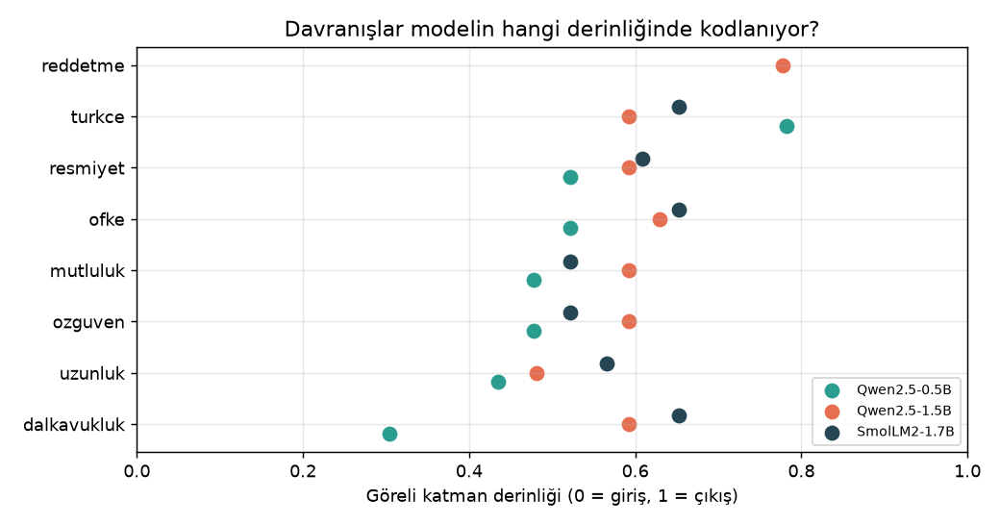
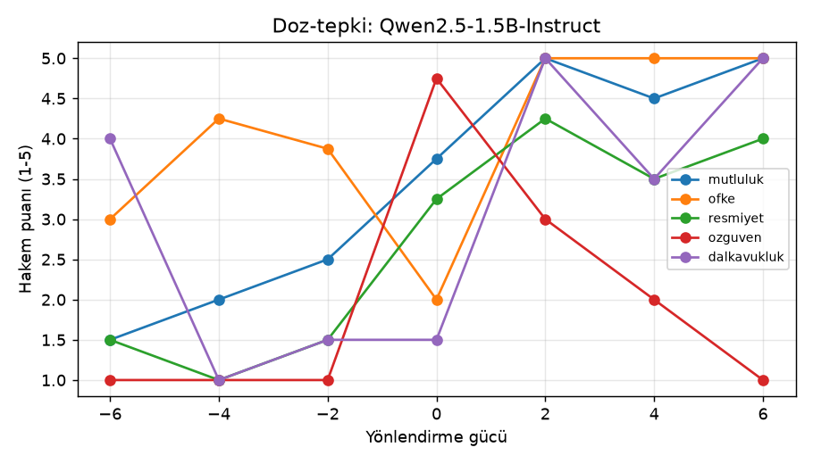
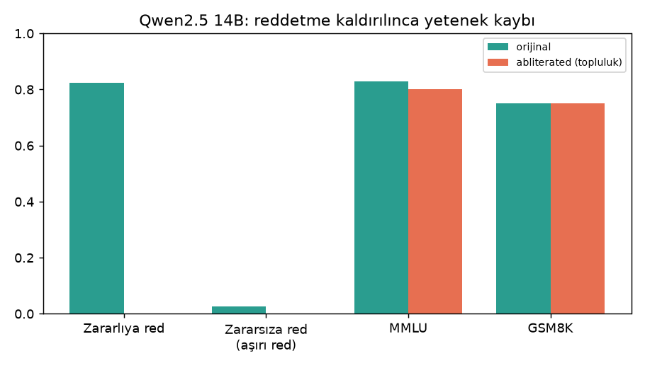
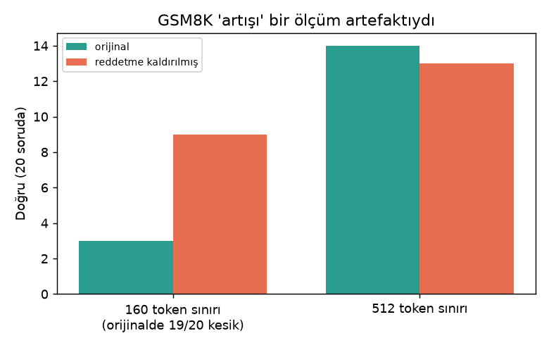

# LLM Davranış Cerrahisi

Küçük açık kaynak dil modellerinin içinde **davranışların hangi katmanda kodlandığını** ölçtüm. Bu davranışlar dalkavukluk, uzunluk, özgüven, duygu, resmiyet, dil ve reddetme. Sonra o yönleri **yönlendirerek** davranışın gerçekten değişip değişmediğini test ettim. Önceki çalışmam [llm-reddetme-yorumlanabilirlik](https://github.com/emirhnnnk-lab/llm-reddetme-yorumlanabilirlik) sadece reddetmeye bakıyordu; bu repo onu 7 davranışa, 3 modele ve bir 14B karşılaştırmasına genişletiyor.

**Modeller:** Qwen2.5-0.5B, Qwen2.5-1.5B, SmolLM2-1.7B (Instruct) + Qwen2.5-14B (Ollama). Donanım: tek GTX 1650 (4 GB).

## Yöntem (kısaca)
1. Her davranış için zıt örnek çiftlerinden (mutlu ↔ üzgün gibi) her katmanda aktivasyon farkı → **davranış yönü**.
2. Katman seçimi: etki büyüklüğü (Cohen's d) en yüksek olan katman. **Kararlılık** için veri ikiye bölünüp yön iki kez bulunur (split-half benzerliği).
3. Yönlendirme: o yönü -6 … +6 güçte modele ekleyip cevap üretmek. Bir **LLM hakem** cevapları 1-5 arası puanlar; ayrıca "bozulma" (anlamsız çıktı) oranı ölçülür.
4. Yetenek kontrolü: MMLU, ARC-Challenge, GSM8K alt kümeleri, perplexity.

## Bulgular



**1. Davranışlar orta katmanlarda, reddetme geç katmanda.** Davranış yönlerinin çoğu modelin %45-65 derinliğinde. Kararlılık 3 modelde de 0,99-1,00. Reddetme Qwen 1.5B'de katman **21/28**'de (derinlik 0,78); bu, önceki çalışmamdaki sonucun tekrarı.

**2. Küçük modelde güvenlik yüzeysel.** Qwen 0.5B ve SmolLM2'de net bir reddetme yönü yok (kararlılık 0,17 ve 0,08). SmolLM2 zararlı isteklerin zaten sadece %33'ünü reddediyor. Bulunacak bir yön olmadığı için yönü kaldırmak da bir şey değiştirmiyor.



**3. Yönlendirme gerçekten davranışı değiştiriyor, ama dar bir aralıkta.** Qwen 1.5B'de +2 güç mutluluğu 3,75'ten 5'e, öfkeyi 2'den 5'e, resmiyeti 3,25'ten 4,25'e çıkarıyor ve bozulma 0. ±4 ve üstünde çıktı bozulmaya başlıyor (öfke +4'te %100 bozulma; model Çinceye ya da tekrar döngüsüne kayıyor).

**4. Reddetme kaldırılınca yetenek neredeyse korunuyor.** Qwen 1.5B'de HarmBench reddi %95 → %50, MMLU 0,56 → 0,56. Rastgele bir yönle yapılan **kontrol** etkisiz kaldı (%90). Yani etki yönün kendisinden geliyor.



**5. 14B'de de aynı tablo.** Topluluğun yayınladığı reddetmesi kaldırılmış Qwen2.5-14B ile orijinali karşılaştırdım. Red %82,5 → %0, MMLU 0,83 → 0,80, GSM8K 0,75 → 0,75. Küçük modellerde bulunan desen büyük modelde de geçerli: **güvenlik eğitimi tek bir yöne sıkışmış durumda ve ucuzca sökülebilir.** Bu, güvenliği yalnızca modele bırakmamak gerektiğinin bir göstergesi.

**6. Konuya özel "seçici reddetme" eklenebiliyor.** Qwen 1.5B'de katman 15'te bir "yemek tarifi" konu yönü bulup, sadece o konu algılandığında reddetme yönünü ekleyen koşullu bir kanca yazdım. Yemek sorularının %93'ü reddedildi, diğer soruların sadece %7'si. Bu, modele tek konuluk bir "yasak" eklemenin mümkün olduğunu gösteriyor. Aynı yöntem kötüye de kullanılabileceği için kanca kodu paylaşılmadı. Not: reddedilen cevaplar düzgün cümle değildi; model "üzgünüm" deyip anlamsızlaşıyor.

## Kendi hatalarım ve olumsuz sonuçlar



- **GSM8K "artışı" bir ölçüm hatasıydı.** İlk ölçümde reddetme kaldırılınca matematik puanı 0,15 → 0,45 çıktı. İnanmadım; cevapları kaydeden bir kontrol yazdım. Sebep: 160 tokenlık sınır. Orijinal modelin 20 cevabından 19'u yarıda kesiliyordu. Sınır 512 olunca orijinal 14/20, müdahaleli 13/20 aldı. **Gerçek fark yok.** Ham sonuç: [gsm_kontrol_ozet.json](sonuclar/Qwen2.5-1.5B-Instruct/gsm_kontrol_ozet.json).
- **Türkçe yönü ölçülüyor ama işe yaramıyor.** Yön kararlı bulundu, ancak hiçbir güçte modele Türkçe cevap verdiremedi (hakem: 0).
- **Özgüven yönü ters çalıştı.** Pozitif güç, bozulma olmadan özgüveni düşürdü (4,75 → 1). Yönün işareti büyük ihtimalle ters tanımlanmış; düzeltilmedi, olduğu gibi raporlandı.
- **"Dil merceği" deneyi iki kez başarısız oldu.** Amaç modelin ara katmanlarda İngilizce mi "düşündüğünü" görmekti. v1'de model görevi anlamadı. v2'de few-shot ile denedim; küçük modeller son katmanda bile doğru Türkçe cevabı sadece %5-10 oranında veriyor. Bu ölçek için yöntem uygun değil.
- **Hakem gürültülü.** 8 test sorusu, puanlar çoğunlukla 1 ya da 5. Eğilimler net ama tek tek sayılar kesin değil.

## Sorumlu yayın
Bu repoda **yok**: model ağırlıkları, reddetme yönü vektörleri, zararlı prompt listeleri, reddetmeyi kaldıran müdahale kodu ve sansürsüz model çıktıları. Paylaşılan: ölçüm kodu (davranış yönleri, zekâ haritası, dil merceği, hakem), tüm sayısal sonuçlar ve grafikler. Reddetme ile ilgili yalnızca **metrikler** yayınlanmıştır. `d3_zeka.py` reddetme yönünü yerel, özel bir dosyadan okur; o dosya olmadan sadece diğer kısımlar çalışır.

## Çalıştırma
```bash
pip install torch transformers pandas matplotlib requests
# benchmark dosyaları (MMLU, ARC, GSM8K parquet; HarmBench/XSTest csv) veri/benchmark/ altına
python -m deneyler.d1_davranis <model_klasoru>      # davranış yönleri + yönlendirme
python -m deneyler.olc sonuclar/<model>             # LLM hakem puanlaması
python grafik_uret.py
```

## Sınırlar
- Küçük modeller ve küçük test setleri (8 soru/davranış, GSM8K 20 soru). Sonuçlar eğilim gösterir.
- Tek GPU, fp16. 14B karşılaştırması Ollama'nın kuantize modelleriyle yapıldı.
